<a href="https://nugas.dev">
  <picture>
    <source media="(prefers-color-scheme: dark)" srcset="./assets/header-dark.svg">
    <source media="(prefers-color-scheme: light)" srcset="./assets/header-light.svg">
    
  </picture>
</a>

<p align="center">
  <a href="https://nugas.dev"></a>
  <a href="https://linkedin.com/in/matheusluznugas"></a>
  <a href="mailto:matheusnugas@gmail.com"></a>
  <a href="https://nugas.dev/articles"></a>
</p>

<p align="center">
  
  
  
</p>

---

### 👋 Hi, I'm Matheus

I build **complete products**, from the React interface to the backend that keeps it running: APIs, queues, data pipelines and integrations, mostly on **AWS**.

I've shipped production software for teams at **Whirlpool Corporation**, **Constellation Network** and **Drummond Advisors**: global e-commerce integrations, multi-tenant SaaS platforms, and event-driven systems that process work in the background without anyone having to think about it.

Before engineering, I spent five years as an **attorney**. That's where I learned to read requirements carefully, write things down, and think about edge cases before they become incidents. It still shapes how I work.

```ts
const matheus = {
  role:      "Senior Fullstack Engineer",
  focus:     ["Fullstack product work", "Event-driven backends", "AWS serverless", "Applied AI"],
  shipping:  "GitHub integrations for an engineering analytics product, streamed through Kafka",
  learning:  "Software Engineering with Applied AI (UNIPDS): RAG, agents and evals on local models",
  principles: [
    "Boring in production",
    "Write it down first",
    "Make failure explicit",
    "Ship the small version",
  ],
};
```

---


### 🚀 Featured work

<table>
  <tr>
    <td width="50%" valign="top">
      <h4>🏠 <a href="https://nugas.dev/projects/property-platform">Real Estate Management Platform</a></h4>
      <p><sub><b>Client work · Senior Fullstack Engineer · team of 3</b></sub></p>
      <p>Multi-tenant property management SaaS for a US startup. I owned the backend pipelines (record enrichment, homeowner guidebooks, timed warranty alerts, a home maintenance planner) and built much of the interface.</p>
      <p><code>API → Lambda → SQS → Chromium worker → S3 → SendGrid</code></p>
      
    </td>
    <td width="50%" valign="top">
      <h4>🎮 <a href="https://github.com/Matheusnugas/Joy2Cloud">Joy2Cloud</a></h4>
      <p><sub><b>Open source · Published on the Chrome Web Store</b></sub></p>
      <p>A Chrome extension that connects Nintendo Switch 2 Joy-Con controllers over <b>Web Bluetooth</b> and exposes them to cloud gaming sites as a virtual Xbox controller.</p>
      <p><code>Manifest V3 · Web Bluetooth · Gamepad API · Playwright</code></p>
      <a href="https://nugas.dev/projects/joy2cloud">Case study →</a>
    </td>
  </tr>
  <tr>
    <td width="50%" valign="top">
      <h4>⌨️ <a href="https://github.com/Matheusnugas/Cloudbind">Cloudbind</a></h4>
      <p><sub><b>Open source · In development</b></sub></p>
      <p>A Chrome extension that lets you play Xbox Cloud Gaming with a keyboard and mouse.</p>
      <p><code>Manifest V3 · Pointer Lock API · WebRTC · Gamepad API</code></p>
      <a href="https://nugas.dev/projects/cloudbind">Case study →</a>
    </td>
    <td width="50%" valign="top">
      <h4>📄 <a href="https://nugas.dev/articles/pdfs-headless-chromium-lambda">Generating PDFs with headless Chromium on Lambda</a></h4>
      <p><sub><b>Article · Nov 2026</b></sub></p>
      <p>How to render PDF reports with headless Chromium inside AWS Lambda: the worker step in the pipeline above.</p>
      <a href="https://nugas.dev/articles">More writing →</a>
    </td>
  </tr>
</table>

<details>
<summary><b>More things I've built</b></summary>
<br>

| Project | What it is | Stack |
| :--- | :--- | :--- |
| [obrato](https://github.com/Matheusnugas/obrato) | Construction management SaaS for small builders | TypeScript |
| [vgc-coach](https://github.com/Matheusnugas/vgc-coach) | Turn-by-turn coach for competitive Pokémon VGC replays | TypeScript |
| [pulsar-url-shortener](https://github.com/Matheusnugas/pulsar-url-shortener) | Link shortener with infrastructure as code | Terraform (HCL) |
| [taskmanagementapi](https://github.com/Matheusnugas/taskmanagementapi) | Task management REST API | NestJS, TypeScript |
| [fastapi-customer-store-api](https://github.com/Matheusnugas/fastapi-customer-store-api) | Customer and store API | Python, FastAPI |
| [geminichatbotv1](https://github.com/Matheusnugas/geminichatbotv1) | Chatbot built on Gemini | TypeScript |

</details>

---

### 🧰 Tech stack

| Area | Tools |
| :--- | :--- |
| **Languages** |  |
| **Backend** |  |
| **Frontend** |  |
| **Cloud & IaC** | <br>Lambda · SQS · EventBridge · DynamoDB · S3 · API Gateway |
| **Data & messaging** |  |
| **Applied AI** | LLM gateways · RAG · Agents · Evals · Ollama · OpenRouter |
| **Mobile & BaaS** | <br>Expo |
| **Testing** | Jest · Playwright |

---

### 📈 Activity

<picture>
  <source media="(prefers-color-scheme: dark)" srcset="https://raw.githubusercontent.com/Matheusnugas/Matheusnugas/output/github-contribution-grid-snake-dark.svg">
  <source media="(prefers-color-scheme: light)" srcset="https://raw.githubusercontent.com/Matheusnugas/Matheusnugas/output/github-contribution-grid-snake.svg">
  
</picture>

---

<p align="center">
  <b>Building something interesting?</b> Let's talk.<br>
  <a href="mailto:matheusnugas@gmail.com">matheusnugas@gmail.com</a> · <a href="https://linkedin.com/in/matheusluznugas">LinkedIn</a> · <a href="https://nugas.dev">nugas.dev</a>
</p>

<p align="center">
  
</p>
